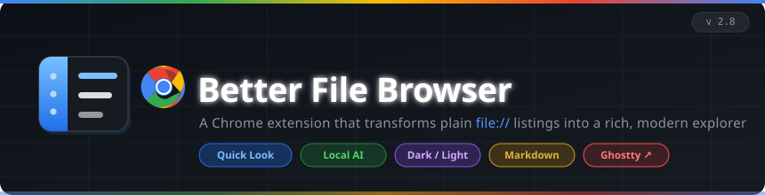
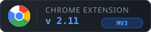

<div align="center">
  
  <br/><br/>
  
  &nbsp;&nbsp;
  
</div>

<br/>

A Chrome extension that replaces plain `file://` directory listings with a file explorer and renders supported files in the same page shell.

---

## Architecture

```
Chrome navigates to a file:// folder or supported file
        │
        ▼
┌─────────────────────────────────────────────────────────────┐
│  loader.js          (run_at: document_start)                │
│  └─ Prevents the default listing from flashing for folders │
└─────────────────────────────────────────────────────────────┘
        │
        ▼
┌─────────────────────────────────────────────────────────────┐
│  content.js         (run_at: document_end)                  │
│  ├─ 1. Detect a listing or a supported file page            │
│  ├─ 2. Read the listing or file contents                    │
│  ├─ 3. Mount one shell with sidebar and page tabs           │
│  └─ 4. Attach file, search, preview, and Notes controls    │
└─────────────────────────────────────────────────────────────┘
        │
        ▼
┌──────────────┬──────────────────────────────────────────────┐
│  SIDEBAR     │  PATH BAR   / Users › alcatraz627 › Code     │
│              ├──────────────────────────────────────────────┤
│  Saved       │  PAGE TABS                                   │
│  Notes       ├──────────────────────────────────────────────┤
│  Recent      │  Toolbar: Find, sort, zoom, view            │
│  Favorites   ├──────────────────────────────────────────────┤
│  System      │  Folder listing or rendered file page       │
└──────────────┴───────────────────────────────────────────────┘
```

---

## Features

### Views
| Mode | Description |
|------|-------------|
| **Details** | Full table — Name, Type, Size, Modified |
| **List** | Compact single-column rows |
| **Tree** | Folder rows expand in place; children load on demand |
| **Tiles** | Medium icon grid with name below |
| **Large Icons** | Oversized icon grid |

Switch with the toolbar buttons. Preference persists across sessions.

### Toolbar
- **Zoom slider** — scales the entire file list proportionally (50–320%)
- **View toggle** — Details / List / Tree / Tiles / Large Icons. Tree reads a folder when you expand it.
- **Search** — live filter by filename as you type (covers all view modes)
- **Hidden files** — show/hide dotfiles with one click
- **Terminal** — open current folder in Ghostty (or copy path to clipboard)
- **Theme** — dark / light toggle; persisted in `localStorage`

### File preview (Quick Look)
Select a file and press **Space** (or click the eye button on hover, or right-click → Preview) for a centered overlay that renders the file in place — Esc closes, ↑/↓ step between previewable files. Renders by type:

| File type | Rendering |
|-----------|-----------|
| `.sh`, `.ts`/`.tsx`, `.py`, `.go`, `.rs`, `.sql`, `.yaml`, `.toml`, `.env`, CSS/HTML… | Syntax highlighting + line numbers |
| `.tsv` / `.csv` | Sortable table; numeric columns detected and right-aligned |
| `.json` | Collapsible tree |
| `.jsonl` / `.ndjson` | One collapsible row per line; malformed lines badged |
| `.md` / `.mdx` | Rendered markdown: headings, code fences, Mermaid diagrams, aligned GFM tables, nested lists, GitHub alerts, footnotes, sanitized inline HTML, bare URLs as links; relative image/link paths resolve against the file |
| `.html` / `.htm` | The page itself in a sandbox, with a Page / Source toggle |
| Images | Fit-to-view, with pixel dimensions (W × H) |
| `.pdf` | Embedded PDF viewer |
| Audio / video (`.mp4`, `.webm`, `.mp3`, `.flac`…) | Native player |
| Fonts (`.ttf`, `.otf`, `.woff`, `.woff2`) | Multi-size glyph specimen |

A **copy** button in the header copies the full raw file contents. Previews fetch `file://` content through the background service worker (page-context `file://` XHR is CORS-blocked in current Chrome), so no extra permissions are required.

### AI (local model) — optional
With the [local-models `lm` CLI](https://github.com/alcatraz627/local-models) installed, the preview gains an **AI bar**: **Summarize**, **Explain** (→ **Describe** for tabular files), and an **Ask** box. Answers stream in and render as markdown; closing the overlay cancels the generation. A status chip shows whether the model is warm/cold/down, and the settings modal has a **Local Model** panel with a live status blinker, a **model picker** (choose any installed model; passed as `-m`), and a **Keep warm / Unload** toggle (runs `lm warm on/off`). Fully local — the extension shells out to `lm` via a native messaging host; no network egress. Requires the `install.sh` step below.

### Keyboard
Every action has a key. **⌘K** opens the command palette (any action, tab, saved place, note or file here). **?** opens a keyboard map you can hover. Holding **⌥** shows each button's key on screen. **F6** walks the areas (sidebar, tabs, path bar, toolbar, listing), and sequences like **g h** (home), **v t** (tree view) and **s m** (sort by modified) cover the rest. The full list is [`docs/keyboard.md`](docs/keyboard.md), generated from `src/keymap.ts`.

### Context menu
Right-click any row or tile for **Preview · Copy path · Copy name · Open in terminal**.

### Tabs
The strip above the toolbar is the working set of one Chrome tab: folders and files, shown on the explorer and on file pages. State lives in `sessionStorage`, so it survives refresh and navigation and ends with the Chrome tab. When a Chrome tab closes, its tabs are kept for a day and listed under **Recent**; a click adds them to the current strip, and nothing is restored on its own. **Recent** also lists the files and folders opened lately. Switching tabs from a page you never kept keeps that page as a tab. The place you are in shows as an italic tab until **t** or a double-click keeps it. **w** closes, **p** pins (pinned tabs sit first with no ✕), **[** and **]** step, **1** to **9** jump, drag reorders, middle-click closes, and **…** on hover offers copy path, save, pin, close and close others. Every gesture and key is listed in [`docs/mouse-key-audit.md`](docs/mouse-key-audit.md). Navigation is real, so the address bar is always the active tab's location.

### Editing any text file
Add folders under **Settings → Notes → Editable folders** (comma-separated, `~` means home). A text file inside one gets an **Edit** button (**e**) on its page: Raw shows the source, Split puts it beside the live render, Rich shows the render alone; anything other than Markdown edits as source. **⌘S** saves through the native host, which refuses paths outside the folder, binary files and files over 2 MB. Each save keeps the previous text for 14 days in `~/Library/Application Support/BetterFileBrowser/backups`. If the file changes on disk while you have unsaved edits, a banner offers **Load from disk** or **Keep mine**. YAML, SQL, CSV and XML files, which Chrome would download, open in their folder's page (`folder/#view=name`) and edit there.

### Sidebar
- **Saved**: one list of your folders. The ★ in the path bar saves or unsaves the current folder, and **+** saves it with the name open for editing. Double-click a label to rename, drag to reorder, ✕ to remove. Hover a row and press **#** to type comma-separated tags. Tagged folders group under a coloured heading, and clicking the heading's dot changes the colour. Bookmarks and My Places from earlier versions are merged in on first load.
- **Notes**: stays in the sidebar and offers folder setup until a Notes folder is selected (see below).
- **Recent**: the files and folders you opened lately.
- **Finder Favourites** and **System**: fixed quick jumps.
- Click a section title to collapse its contents. Collapse choices persist across reloads; Settings can hide Recent, Finder Favourites, or System entirely. The folder icon beside Notes opens its folder.
- All sidebar state persists in `localStorage`.

### Notes
The **Notes** section stays visible in the sidebar. Click **Choose folder** (or **Type it in Settings**) to select a local folder. The native messaging host must be installed to read or write it. Notes are ordinary `.md` files in that folder. Pinned notes come first, then notes with a shared `pos` order key, then the rest newest-created first; editing a note does not move it. The filter box matches titles, file names, colours and `#tags`; switch **Names** to **Deep** in the box to search the notes' text too.

Press **n** or click **+** to create an empty note. Clicking a note opens the editor in the preview panel, with source on the left and rendered Markdown on the right. The toolbar covers bold, italic, code, strikethrough, headings, links, quotes, bullet and numbered lists, tasks, tables, images and versions. ⌥↑↓ moves lines; ⌥⇧↑↓ duplicates them; Tab indents; Enter continues a list. Pasted, dropped, or chosen images are saved under `attachments/` and linked from the note.

**Saving:** A 1.5-second pause saves automatically. **⌘S** saves immediately, and closing a dirty editor starts a save. The header shows an unsaved dot or a save error. A new note gets its filename from its first heading or first nonblank line on the first save. If another tool changes the file, the next save reports a conflict and offers reload or overwrite. A removed file produces a save error without recreating it. Double-click a sidebar label to rename; ✕ moves the note to `.trash/`.

The tab icon on a note row opens its **rendered file page as a tab in this page's strip**. The editor remains in the preview panel; the tab is a reading view. ⌥-click or the editor's **+ tab** keeps it in the background. [The Notes folder contract](docs/notes-contract.md) describes paths, attachments, and cross-tool use.

### File pages
A file opened directly in the tab (markdown, code, json, jsonl, tsv/csv, txt) renders like the preview instead of Chrome's plain text, inside the same shell as a folder listing, so the sidebar, the strip and the path bar stay put. The main column carries a heading table of contents for markdown, **r** for raw, a remembered scroll position, and a re-render whenever the file changes on disk. The **Reading width** button cycles through Full, XL, LG, and MD; Settings can choose the starting width. Text size scales the whole interface. Paths beginning `/Users/alcatraz627` in Markdown become links that open in a new tab, including paths with spaces and `:line` references. Settings can limit file pages to non-markdown files or turn them off if you keep another markdown extension on file URLs. **Settings → Exclusions** lists extensions that Chrome opens natively; `.pdf`, `.html`, and `.htm` are excluded by default. Remove `.html` or `.htm` to show their source in the file page.

### Find and saved views
The Filter panel's second row searches **text inside files**: the text files the name and type fields allow (2 MB each at most) are read through the service worker, with four reads shared across browser tabs. A separate **Text regex** checkbox applies to file contents. Results show the first matching line and the number of matches in each file. The Details view adds a Matches column while content results are shown. Cancel leaves a labelled partial result; changing a query stops its old scan. **Save view** keeps the folder plus the query as a Saved row with a funnel icon; the row is a plain URL with the query in its hash, so opening it brings the search back, and a hash change on an open page applies it in place.

### Deep search
The folder button beside the filter box includes subfolders. Names show their path from the current folder, so `src/main.ts` matches `main`. The scan skips `node_modules`, `.git` and dot-folders, stops at 5000 items, and uses the selected depth limit (1, 2, 4, or 8 levels). Filename regex matching runs in a worker with a time limit, so a costly pattern cannot hold the page open indefinitely.

Details-view columns are resizable: drag a header's right edge; widths persist. A plain click on a file opens it in the panel and leaves the address bar alone. A plain click on a folder goes there. Double-click opens a file's page in this tab, ⌥-click keeps the item as a background strip tab, and middle-click opens a Chrome tab. Rows support multi-select (shift-click or ⌘/ctrl-click toggles, ⇧⌘-click ranges, ⌘A), and ⌘C copies the selected paths.

### Breadcrumbs
Each path segment has a chevron button that lists that folder's contents with a focused filter box — type to narrow, Enter opens the first match.

### File Icons
30+ file types with distinct SVG icons and per-extension colour coding:

| Category | Colour |
|----------|--------|
| JS / MJS | Golden yellow |
| TS / TSX / JSX | Blue / Cyan |
| HTML / CSS | Orange / Deep blue |
| Python / Go / Rust | Blue variants |
| Images | Purple |
| Video / Audio | Red / Orange |
| Archives | Brown |
| JSON / YAML | Teal / Red |

Special folders (Desktop, Documents, Downloads, Code, etc.) render in amber; generic folders in blue.

### Tooltips
Hover any item for a rich tooltip showing:
- Full filename
- Full path
- File type
- Size (formatted)
- Modified date
- Hidden file indicator (if dotfile)


---

## Installation

### 1. Load the extension

1. Open `chrome://extensions/`
2. Enable **Developer mode** (top-right toggle)
3. Click **Load unpacked** → select this folder (`better-file-browser/`)
4. On the extension card → **Details** → enable **"Allow access to file URLs"**

### 2. Native messaging hosts

```bash
# Find your Extension ID on chrome://extensions, then:
cd native/
./install.sh <your-extension-id>
```

This registers three native messaging hosts:
- **Ghostty launcher** — lets the terminal button open Ghostty directly in the current folder. Without it, the button copies the path to your clipboard instead.
- **lm bridge** — lets the preview's AI bar run the local `lm` CLI. Without it (or without `lm` installed), the AI bar simply doesn't appear; everything else works unchanged.
- **Notes host** — reads and writes the folder selected in Settings → Notes. Notes stays visible in the sidebar without the host, but lists and edits need it.

---

## What's not supported

| Feature | Reason |
|---------|--------|
| System Finder icons (`.icns`) | Chrome's extension sandbox cannot read macOS metadata APIs |
| Live Finder sidebar sync | Favourites live in a binary plist inaccessible from a browser extension |
| File permissions / creation date | Require a native filesystem agent |
| Image dimensions in tooltips | Require loading each image — possible future enhancement with native host |

---

## File structure

```
better-file-browser/
├── manifest.json               MV3 extension manifest
├── loader.js                   document_start: hides Chrome listing before render
├── content.js                  document_end: bundled output (esbuild) — DO NOT edit by hand
├── background.js               service worker: file:// fetch relay + native-host proxy
├── build.ts                    esbuild bundler (src/ → content.js)
├── src/                        TypeScript sources (entry: main.ts)
│   ├── main.ts                 entry: decide listing vs file, build the shell once, hand each part to its module
│   ├── app.ts                  the shared page context: identity, live settings, the hooks modules hand each other
│   ├── page.ts                 the page shell (path bar, sidebar, main column, the two dialogs) as one HTML string
│   ├── listing.ts              the folder listing: sort, group, filter, text and deep search, view, selection
│   ├── listing-input.ts        pointer and keyboard for the listing: click model, hover tip, context menu, keydown router
│   ├── sidebar.ts              the Saved list, the Notes list, and the bookmark gestures shared by rows, crumbs, dropdown
│   ├── strip.ts                the tab strip of one Chrome tab (sessionStorage state + local recovery); pure ops in tabs.ts
│   ├── chrome.ts               the path bar's own controls: theme toggle, terminal button, crumb dropdown
│   ├── dialog.ts               one dialog chrome (title, tab strip, one scrolling pane) for Help and Settings
│   ├── settings-ui.ts          fills and saves the Settings and Help panes, the icon-rule editor, the local-model card
│   ├── help.ts                 the in-product help text, one markdown doc per Help tab
│   ├── preview.ts              Quick Look panel (modal or docked) + AI bar + note editor
│   ├── file-page.ts            takeover for a file opened directly in the tab
│   ├── md-ui.ts                behaviour inside rendered markdown: code-block copy, image opens natively
│   ├── renderers.ts            pure render fns: code/DSV/JSON/JSONL/markdown (unit-tested)
│   ├── deep-search.ts          pure subtree crawler behind the deep search toggle
│   ├── tabs.ts · places.ts     pure cores for the tab strip and the Saved list
│   ├── notes.ts · editor.ts    notes host client + front matter; undo/insert core
│   ├── llm.ts                  native-messaging client for the lm CLI
│   ├── file-fetch.ts           service-worker fetch relay client (retries, error codes)
│   ├── toast.ts · styles.ts · el.ts   status message; injected CSS; the two element lookups
│   ├── parse.ts · render.ts · sort-filter.ts · icons.ts · storage.ts · utils.ts · types.ts
├── tests/                      vitest unit tests
├── e2e/                        browser harness + smoke run (npm run e2e)
├── docs/                       documentation map, Notes contract, design records
├── icon.svg                    Extension icon (dark rounded square + folder)
├── README.md
└── native/
    ├── ghostty_launcher.py     Native host: opens Ghostty
    ├── llm_host.py             Native host: bridges the preview AI bar to the lm CLI
    ├── notes_host.py           Native host: reads and writes notes in one folder
    ├── test_notes_host.py      Protocol test for the notes host
    ├── install.sh              Registers the three hosts with Chrome
    └── com.better_file_browser.{ghostty,llm,notes}.json  Host manifest templates
```

[Documentation map](docs/README.md) separates current guides from earlier
plans and links the [Notes audit](docs/notes-audit-20260922.md).

---

## Development

Logic lives in `src/` (TypeScript) and bundles to `content.js` via esbuild.

```bash
npm install
npm run build      # src/ → content.js  (npm run watch for incremental)
npm test           # vitest unit tests (renderers, parsing, storage, crawler, tabs)
npm run e2e        # browser run: Chrome for Testing + puppeteer, screenshots in e2e/shots/
npm run e2e:light  # the same checks on the light theme
```

The e2e harness needs Chrome for Testing once: `npx @puppeteer/browsers install chrome@stable`. `BFB_CHROME` overrides the binary, `BFB_HEADED=1` shows the window.

After a build:

1. Open `chrome://extensions/`
2. Click the refresh icon on the **Better File Browser** card
3. Reload any open `file://` tab

`content.js` is generated — never edit it by hand; edit `src/` and rebuild. The extension makes no remote network requests; the only `fetch` calls read local `file://` URLs (via the service worker) and, if enabled, the AI bar talks to the local `lm` CLI through a native host.

---

## Changelog

| Version | Highlights |
|---------|------------|
| **2.12** | Bare URLs link; fence aliases, case-free SQL, YAML values and coloured Raw; YAML/SQL/CSV/XML open in the explorer; edit any text file in folders you allow; HTML page preview; nested lists, alerts, footnotes; contents in the sidebar; no surprise tab restore, files in Recent; Notes text search and toolbar; every listed terminal opens. [Release details](docs/release-2.12.md) |
| **2.11** | Clickable sidebar titles; Notes reading tabs; Markdown HTML, fences, table and path-link fixes; reading width and text size; interface polish; bounded filename regex matching. [Release details](docs/release-2.11.md) |
| **2.10** | Lazy Tree view; HTML/PDF native-page exclusions; more syntax highlighting; Find snippets, counts, content regex and depth limit; cancellable, bounded search across tabs; Markdown Mermaid diagrams and reading controls |
| **2.9** | One shell for listings and file pages; the strip belongs to the Chrome tab with recovery, file tabs, pins and a hover menu; click model (click looks, double-click goes, alt keeps a tab); sidebar rows open as strip tabs; Saved filter box; Help and Settings on one tabbed dialog; file page fills the width; a written mouse and key contract with a tooltip on every control |
| **2.8** | Tabs (shared working set), Saved list replacing Bookmarks + My Places (names, tags, colours), Notes editor with a native host and a documented file contract, rendered file pages with ToC and autoreload, deep search, preview docks to the side or floats and resizes, preview links open in new tabs, sort/group persist, relay retry + reloaded-extension message, in-repo e2e harness |
| **2.7.1** | Image dimensions (W × H) in the preview |
| **2.7** | AI bar model picker (`-m`) + Keep-warm/Unload toggle |
| **2.6** | Syntax-highlighter upgrade — categorized keywords (control/type/builtin/literal), Python triple-quotes & string prefixes, Rust raw strings, decorators, richer numbers |
| **2.5** | Markdown relative-path resolution; PDF / audio / video / font previews |
| **2.4** | Date-parse fix (epoch, not the locale string — also fixes date sorting); multi-select with bulk copy; resizable columns; custom "My Places" sidebar |
| **2.3** | Documented the v2.x features; manifest/package version sync |
| **2.2** | TypeScript + esbuild + vitest migration; settings modal |
